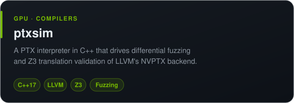
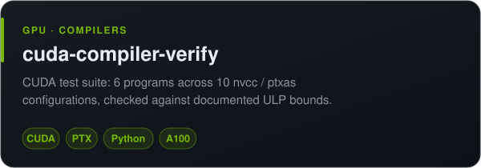
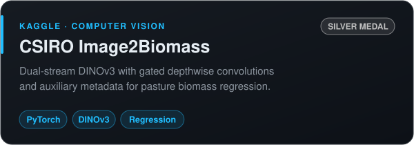
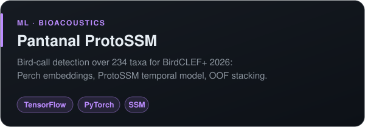
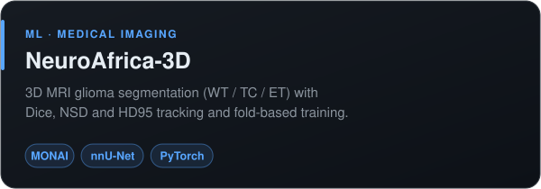

  

  
  
  

### 👋 About me

- 🔭 I build tools that test GPU compilers: a PTX interpreter, fuzzers for LLVM's NVPTX backend, and a CUDA test suite
- 🧠 On the ML side: computer vision, bioacoustics, medical imaging and federated reinforcement learning
- 🏆 Kaggle Competitions Expert, with a silver medal in CSIRO Image2Biomass
- 🎓 Electrical Engineering @ NSUT Delhi; research internships at IIT Delhi, IIT Kharagpur and Heriot-Watt University
- 💬 Ask me about warp shuffles, compiler fuzzing or DINOv3

### ✨ Featured work

  
  
  
  
  
  

  Also: <a href="https://github.com/Divabhattacharya/cudasmith">cudasmith</a> (in progress) ·
  <a href="https://github.com/Divabhattacharya/livekit-barge-in-agent">LiveKit barge-in agent</a> ·
  <a href="https://github.com/Divabhattacharya/covid-vaccine-tweet-sentiment">tweet sentiment</a> ·
  <a href="https://github.com/Divabhattacharya/resume-screening-nlp">resume screening</a>

### 🧰 Toolbox

  
  
  
  

### 🐍 Contributions

<picture>
  <source media="(prefers-color-scheme: dark)" srcset="https://raw.githubusercontent.com/Divabhattacharya/Divabhattacharya/output/github-snake-dark.svg"/>
  
</picture>
